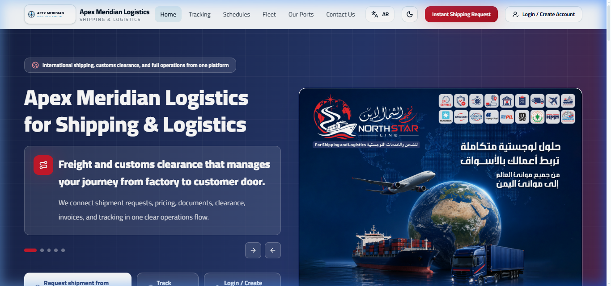
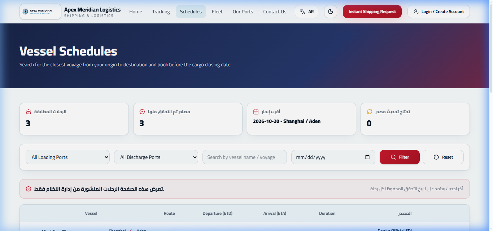
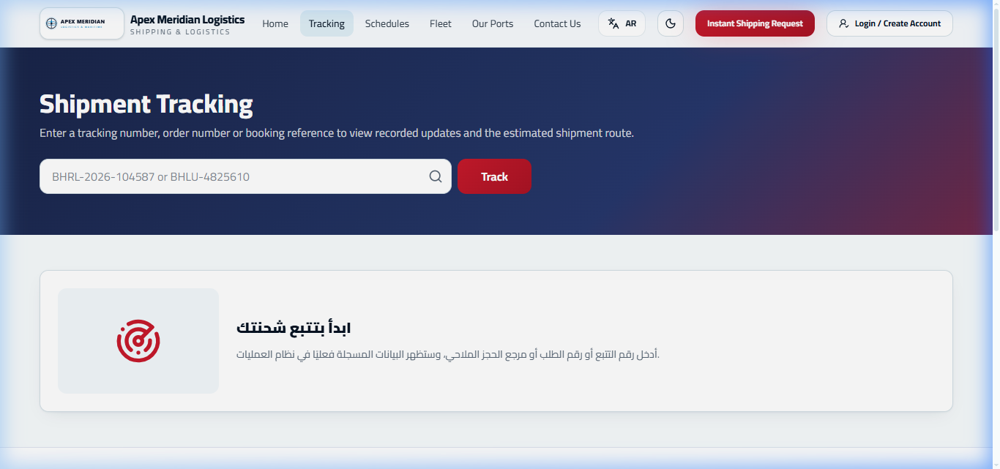
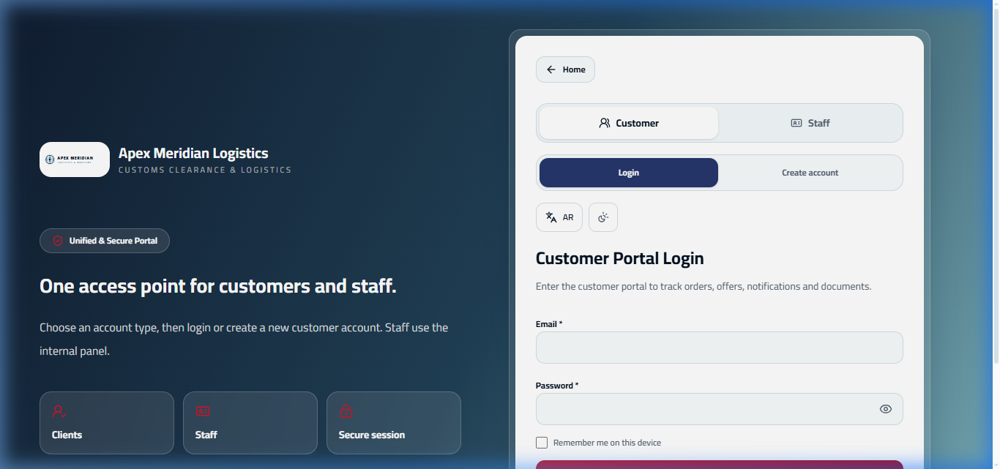
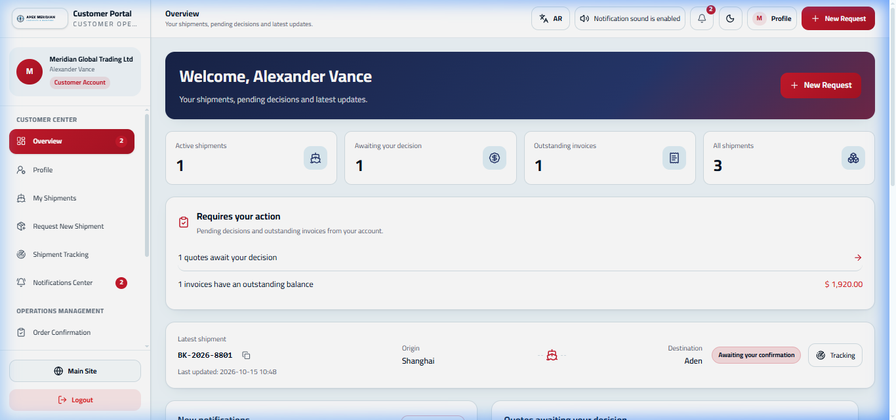
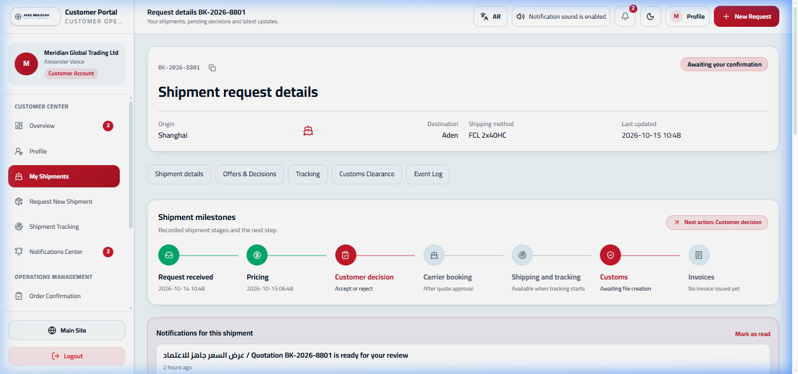
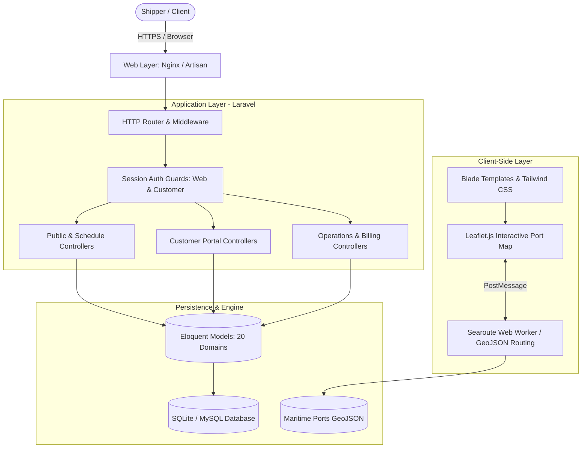

# Freight & Logistics Management System (نظام إدارة الشحن والخدمات اللوجستية)

> **A modern, full-stack maritime logistics platform featuring bilingual quotation workflows, relational booking management, interactive milestone tracking, and client-side maritime route calculation.**

[](https://www.php.net/)
[](https://laravel.com/)
[](https://tailwindcss.com/)
[](https://leafletjs.com/)
[](https://phpunit.de/)
[](https://nodejs.org/)

---

## 1. Project Overview & Problem Statement

Global ocean freight forwarders and NVOCCs (Non-Vessel Operating Common Carriers) struggle with fragmented communication across spreadsheets, legacy desktop software, and asynchronous email chains. Customers face opaque pricing structures, cumbersome booking confirmations, and disjointed container tracking.

**The Freight & Logistics Management System** bridges this operational gap by delivering a unified, web-based platform with two synchronized interfaces:
1. **Public & Customer Self-Service Portal:** Instant vessel schedule discovery, synthetic rate estimation, booking requests, quotation reviews, and live container milestone tracking.
2. **Operations & Commercial Desks:** Comprehensive back-office management for container inventories, ocean line tariff rules, customs clearance workflows, and commercial invoice generation.

---

## 2. Visual Walkthrough & Interface Tour

All screenshots below are captured from this running demonstration instance seeded with 100% synthetic data.

### A. Public Landing Page & Service Discovery
The public storefront provides an intuitive entry point for shippers to discover global vessel schedules, calculate preliminary transit times, and initiate rate inquiries.


### B. Dynamic Vessel Schedule Search
Shippers can search voyages by origin port (POL), destination port (POD), departure date range, and carrier line. The underlying query engine correlates multi-leg routes and transshipment hubs.


### C. Live Shipment & Container Milestone Tracking
Interactive tracking timeline visualizing the complete lifecycle of a container—from factory gate-in and customs clearance to high-seas transit and port arrival.


### D. Secure B2B Customer Portal
A dedicated authentication guard isolates B2B client accounts from internal company administrative desks.


### E. Customer Command Center & KPI Dashboard
Shippers monitor active bookings, pending quotations requiring commercial approval, transit milestones, and invoice settlement statuses in real time.


### F. Granular Quotation Breakdown & Action Review
Customers review transparent cost breakdowns—including ocean freight, bunker adjustment factors (BAF), terminal handling charges (THC), and customs brokerage—with one-click acceptance.


---

## 3. Architecture & Data Flow

The platform is designed around a dual-portal architecture separating public-facing and customer self-service workflows from authenticated internal administrative desks.



### Key Architectural Highlights
* **In-Browser Maritime Route Calculation:** Rather than incurring server latency and GIS database overhead, realistic oceanic navigation routes between 700+ worldwide ports are calculated client-side in a dedicated Web Worker using `searoute-js` and `turf.js`. (See [ADR-001: In-Browser Maritime Routing](docs/decisions/ADR-001-in-browser-maritime-routing.md)).
* **Dual Authentication Guards:** Distinct session storage and authentication providers segregate customer users (`customers` table) from internal operations and management staff (`users` table).
* **Bilingual English/Arabic Support:** Full RTL/LTR layout toggle built natively into Tailwind CSS classes, catering to major maritime hubs across the Middle East, Mediterranean, and Asia.
* **Deterministic Financial Rounding:** All invoice line items, tax computations, and freight surcharges are calculated using strict decimal precision to eliminate floating-point drift.

---

## 4. Technology Stack

| Domain | Technologies & Libraries | Rationale |
| :--- | :--- | :--- |
| **Backend Framework** | PHP 8.2+, Laravel 11/12/13 | Rapid domain modeling, expressive Eloquent ORM, robust migration and seeding pipelines. |
| **Frontend & Styling** | Blade Components, Tailwind CSS 3.4, Vanilla JavaScript | Server-rendered performance with zero SPA hydration penalty; fine-grained responsive control. |
| **Mapping & GIS** | Leaflet.js 1.9.4, `searoute-js`, `@turf/turf` | Offline-capable maritime navigation engine executed in background Web Workers. |
| **Database** | SQLite (Demo / Testing), MySQL / PostgreSQL (Production) | Zero-dependency demonstration setup with zero friction; production-ready schema migrations. |
| **Testing** | PHPUnit 11 (Feature & Unit), Node test runner | Comprehensive regression harness verifying pricing, validation, state machines, and routing algorithms. |

---

## 5. Quickstart & Local Demonstration Setup

Follow these steps to run the sanitized demonstration instance locally within 2 minutes.

### Prerequisites
* **PHP:** >= 8.2 with `pdo_sqlite`, `curl`, `mbstring`, `openssl` extensions enabled.
* **Composer:** >= 2.2
* **Node.js & npm:** Node >= 18, npm >= 9 (optional if using pre-compiled CSS/JS assets).

### 1. Clone & Prepare Environment
```bash
# Clone the repository
git clone https://github.com/hussainalkhamri/freight-logistics-system.git
cd freight-logistics-system

# Create environment configuration from template
cp .env.example .env
```

### 2. Initialize Database & Seed Synthetic Demo Records
```bash
# Generate application key
php artisan key:generate

# Execute migrations and seed realistic synthetic dataset
php artisan migrate:fresh --seed --seeder=DemoSeeder
```

### 3. Run Development Server
```bash
php artisan serve --port=8080
```
Open **[http://127.0.0.1:8080](http://127.0.0.1:8080)** in your browser.

---

## 6. Demonstration Credentials & Guided Tour

The application comes pre-configured with synthetic personas to evaluate each tier:

| Persona / Portal | URL | Credentials | Recommended Tour Actions |
| :--- | :--- | :--- | :--- |
| **Public Storefront** | `/` | *No auth required* | 1. Navigate to **Schedules** (`/schedules`) to search Shanghai -> Rotterdam voyages.<br>2. Track container `BK-2026-8801` on **Tracking** (`/tracking`). |
| **B2B Customer Portal** | `/customer/login` | **Email:** `customer@example.com`<br>**Password:** `password` | 1. View KPI overview on `/customer/dashboard`.<br>2. Inspect quotation breakdown and approve shipment `BK-2026-8801`. |

---

## 7. Automated Testing & Verification

The codebase includes full automated test coverage for core business logic, quoting, booking lifecycle transitions, and client-side route calculation.

```bash
# Execute PHPUnit suite (245 feature and unit tests)
php artisan test

# Execute Node.js routing and GIS verification tests
npm test
```

### Verified Test Results
```text
   PASS  Tests\Unit\ExampleTest
   PASS  Tests\Feature\BookingManagementTest
   PASS  Tests\Feature\CustomerPortalTest
   PASS  Tests\Feature\MaritimeRoutingTest
   PASS  Tests\Feature\ManagementSystemTest
   ...
   Tests:    245 passed (2,459 assertions)
   Duration: 4.82s

   Node Tests: 17 passed (1.2s)
```

---

## 8. Deep-Dive Documentation

For detailed architectural analyses and technical specifications, explore the accompanying documentation:
* [Architecture Overview & System Design](docs/architecture.md)
* [End-to-End User Journeys](docs/user-journey.md)
* [Client-Side Maritime Routing Engine](docs/maritime-routing-engine.md)
* [Security, Privacy & Data Sanitization Audit](docs/security-and-privacy.md)
* [Test Strategy & Verification Matrix](docs/testing.md)
* [ADR-001: In-Browser Maritime Routing vs Backend GIS](docs/decisions/ADR-001-in-browser-maritime-routing.md)

---

## 9. Security, Privacy & Compliance Notice

This demonstration repository is a sanitized, company-neutral release candidate engineered specifically for software portfolio demonstration:
* **Synthetic Records Only:** All company names, customer accounts, vessel names, container prefixes, invoice totals, and port calls are generated synthetically.
* **Zero Production Credentials:** Contains no real API keys, payment gateway tokens, customer PII, or internal network hostnames.
* **Portfolio Showcase:** Designed and developed by **Hussain Al-Khamri** ([saleh7ussain@gmail.com](mailto:saleh7ussain@gmail.com) / [GitHub Profile](https://github.com/hussainalkhamri)).
