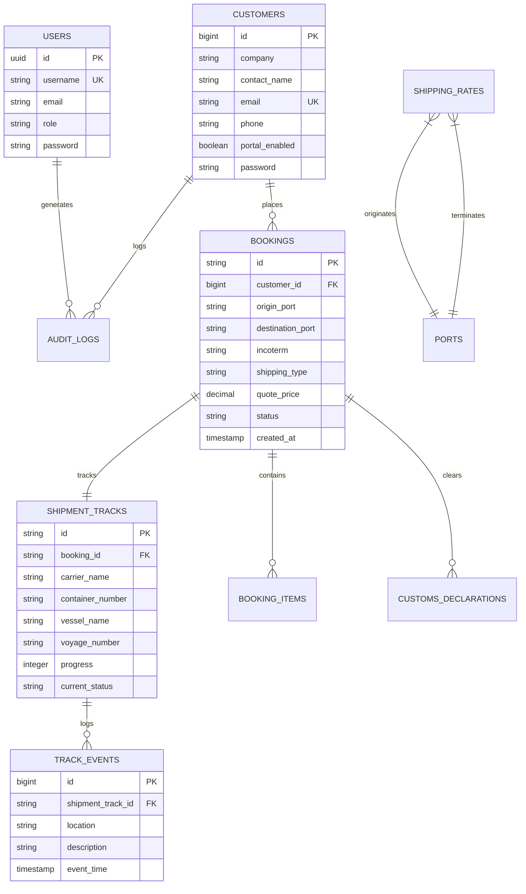

# Shipping and Logistics Management System — Enterprise Technical & Business Master Guide

> **Target Audience:** Senior Full-Stack Engineers, Software Architects, Technical Leads, Logistics Product Managers, and Candidates preparing for High-Level Technical & Domain Interviews.  
> **System Classification:** Multi-modal Freight Forwarding ERP, NVOCC Operating System, and Customer Self-Service Portal.  
> **Core Stack:** Laravel 11 (PHP 8.5+), Blade, Vanilla CSS with Design Variable Tokens, Leaflet GIS Maritime Engine, SQLite/MySQL, Node.js Test Harness, Playwright E2E Suite.

---

## Table of Contents
1. [Executive Summary & System Vision](#1-executive-summary--system-vision)
2. [Maritime & Global Logistics Domain Primer (Business Concepts)](#2-maritime--global-logistics-domain-primer)
   - [2.1 NVOCC vs Freight Forwarder vs Vessel Carrier (VOCC)](#21-nvocc-vs-freight-forwarder-vs-vessel-carrier-vocc)
   - [2.2 Bills of Lading: MBL vs HBL, Negotiable vs Sea Waybill](#22-bills-of-lading-mbl-vs-hbl-negotiable-vs-sea-waybill)
   - [2.3 Incoterms® 2020: Risk, Cost, and Title Transfer](#23-incoterms-2020-risk-cost-and-title-transfer)
   - [2.4 Container Equipment: TEU, FEU, HC, Reefers, and VGM](#24-container-equipment-teu-feu-hc-reefers-and-vgm)
   - [2.5 Financial Penalties: Demurrage, Detention, and Port Storage](#25-financial-penalties-demurrage-detention-and-port-storage)
   - [2.6 Customs Clearance Lifecycle: HS Codes, Valuation, and Channels](#26-customs-clearance-lifecycle-hs-codes-valuation-and-channels)
3. [System Architecture & Engineering Decisions](#3-system-architecture--engineering-decisions)
   - [3.1 High-Level Architectural Diagram](#31-high-level-architectural-diagram)
   - [3.2 Single Source of Truth: Centralized Dynamic Configuration](#32-single-source-of-truth-centralized-dynamic-configuration)
   - [3.3 Tokenized Visual Design System (Zero CSS Clutter)](#33-tokenized-visual-design-system)
   - [3.4 Dual Guard Authentication (Staff vs Customer Isolation)](#34-dual-guard-authentication)
   - [3.5 Role-Based Access Control (RBAC) & Pipeline Separation](#35-role-based-access-control-rbac)
   - [3.6 Maritime Routing & Geodesic GIS Engine](#36-maritime-routing--geodesic-gis-engine)
   - [3.7 Immutable Audit Logs & Governance](#37-immutable-audit-logs--governance)
4. [Database Modeling & Entity Relationships](#4-database-modeling--entity-relationships)
5. [Automated Testing Strategy & Verification](#5-automated-testing-strategy--verification)
   - [5.1 Unit & Feature Test Suites (PHPUnit)](#51-unit--feature-test-suites-phpunit)
   - [5.2 GIS & Worker Mathematical Harness (Node.js)](#52-gis--worker-mathematical-harness-nodejs)
   - [5.3 End-to-End Browser Testing (Playwright)](#53-end-to-end-browser-testing-playwright)
6. [Senior Interview Preparation: Technical & Domain Q&A](#6-senior-interview-preparation-technical--domain-qa)
   - [Part A: System Design & Backend Architecture Questions](#part-a-system-design--backend-architecture-questions)
   - [Part B: Maritime, Logistics, and Supply Chain Domain Questions](#part-b-maritime-logistics-and-supply-chain-domain-questions)
   - [Part C: How to Pitch This Project to Recruiters and CTOs](#part-c-how-to-pitch-this-project-to-recruiters-and-ctos)

---

## 1. Executive Summary & System Vision

The **Shipping and Logistics** system is an enterprise-grade ERP designed to unify all operational, commercial, and regulatory workflows of an international logistics organization into a consolidated, zero-fluff digital operating environment.

Unlike consumer marketing websites, this platform functions strictly as an **Operational Gateway & Digital Command Center**:
- **Public Surface:** Provides clean, secure direct access doors into:
  1. Internal Operations Desk (`/login`)
  2. Customer Self-Service Portal (`/customer/login`)
  3. Instant Container/Waybill Telemetry Tracker (`/tracking?q=...`)
  4. Global Vessel & Port Schedules Directory (`/schedules`)
  5. Digital Shipment Booking & Quotation Engine
- **Core Operations:** Manages multi-modal shipments (Ocean FCL/LCL, Air Freight, Overland Trucking), rate sheet catalogs, instant customer quotation generation, customs clearance dossiers, and accounts receivable/payable.
- **Architectural Tenet:** **True Dynamic Configurability**. Modifying company branding, corporate name, logos, legal tax IDs, or theme colors requires **editing exactly one configuration source (`config/company.php`) and CSS tokens**, propagating automatically across layouts, transactional PDFs, automated email notifications, and customer portal views.

---

## 2. Maritime & Global Logistics Domain Primer

To interview with authority, you must understand not just how the code is structured, but the exact real-world legal, financial, and physical reality that each database table and API route represents.

### 2.1 NVOCC vs Freight Forwarder vs Vessel Carrier (VOCC)
- **VOCC (Vessel Operating Common Carrier):** Ocean carriers that own or lease container ships (e.g., Maersk, MSC, COSCO). They sell container slot capacity on vessels.
- **Freight Forwarder:** An intermediary/travel agent for cargo. Arranges transportation, handles documentation, books space with carriers, but historically acts only as an agent without issuing bills of lading under its own carrier liability.
- **NVOCC (Non-Vessel Operating Common Carrier):** A freight consolidation and forwarding company that operates as a carrier legally without owning ships. An NVOCC issues its own **House Bill of Lading (HBL)**, accepts full common carrier liability for loss/damage, and leases container slots from VOCCs under a **Master Bill of Lading (MBL)**.
- **System Role:** This ERP positions the operating enterprise as an **advanced NVOCC and International Freight Forwarder**, capable of issuing HBLs, managing MBL references, negotiating carrier ocean contracts, and servicing direct commercial shippers.

### 2.2 Bills of Lading: MBL vs HBL, Negotiable vs Sea Waybill
The Bill of Lading (B/L) is the single most vital document in global trade, fulfilling three legal roles:
1. **Receipt of Goods:** Confirmation by the carrier that cargo was received in apparent good order.
2. **Document of Title:** Ownership document that controls physical release of goods at the destination port.
3. **Contract of Carriage:** The legal terms governing transit between shipper and carrier.

#### Key Distinctions:
- **Master Bill of Lading (MBL):** Issued by the ocean line (VOCC) to the NVOCC. The shipper is the NVOCC’s origin agent; the consignee is the NVOCC’s destination agent.
- **House Bill of Lading (HBL):** Issued by the NVOCC to the actual commercial exporter/importer. The shipper is the actual factory/seller; the consignee is the buyer.
- **Negotiable Original B/L ("To Order"):** Requires presentation of the physical, endorsed paper bill of lading before the container is released. Used under Letters of Credit (L/C).
- **Telex Release / Surrender:** The original paper B/L is surrendered at the origin port, and the origin agent sends an electronic release signal to the destination port to release cargo without physical document presentation.
- **Sea Waybill (Express B/L):** Non-negotiable document. Ownership is not transferred via paper; cargo is released directly to the named consignee upon identity verification. Faster, ideal for trusted business partners.

### 2.3 Incoterms® 2020: Risk, Cost, and Title Transfer
Incoterms (International Commercial Terms) define the exact point where cost liabilities and risk of damage transfer from the Seller to the Buyer:

| Incoterm | Full Name | Seller Obligation | Buyer Obligation | Risk Transfer Point |
|---|---|---|---|---|
| **EXW** | Ex Works | Make goods available at seller's factory | Everything (pickup, export, ocean freight, import duties, delivery) | Seller's factory floor |
| **FOB** | Free on Board | Inland transport, export customs, loading onto ship | Ocean freight, destination clearance, inland delivery | Once cargo is loaded safely on vessel at origin port |
| **CFR** | Cost and Freight | Inland transport, export clearance, ocean freight to destination port | Marine insurance, destination port fees, customs clearance, final haulage | Once loaded on vessel (seller pays freight, but buyer bears transit risk) |
| **CIF** | Cost, Insurance & Freight | Same as CFR + Marine insurance policy | Destination terminal handling (THC), customs clearance, inland haulage | Loaded on vessel (insurance protects buyer) |
| **DAP** | Delivered at Place | Transport all the way to buyer's facility; seller bears all transit risk | Import customs clearance, duties, and VAT taxes | Arrival of vehicle ready for unloading at buyer's facility |
| **DDP** | Delivered Duty Paid | Complete door-to-door solution: transport, insurance, export/import clearance, all duties and taxes | Unloading goods at destination warehouse | Buyer's warehouse |

*In the system:* The `shipping_rates` catalog and `bookings` workflow dynamically calculate quotations based on these Incoterms, adjusting whether origin handling, ocean freight, customs clearance, or final inland trucking are billed.

### 2.4 Container Equipment: TEU, FEU, HC, Reefers, and VGM
- **TEU (Twenty-Foot Equivalent Unit):** Industry standard unit of cargo capacity based on a 20-foot shipping container (approx. 20' x 8' x 8'6", ~33.2 cubic meters / CBM volume, max payload ~25,000 kg).
- **FEU (Forty-Foot Equivalent Unit):** A standard 40-foot container (equal to 2 TEUs, ~67.7 CBM).
- **40' High Cube (40HC):** Extra foot taller (9'6" height), volume of ~76.4 CBM. The workhorse of light manufactured goods.
- **Reefer (Refrigerated Container):** Contains integrated generator and cooling unit to maintain temperatures from -30°C to +30°C for perishables and pharmaceuticals.
- **Tare Weight vs Gross Weight vs Payload:**
  - *Tare Weight:* Weight of empty container (~2,200 kg for 20', ~3,800 kg for 40').
  - *Payload:* Maximum allowable weight of cargo packed inside.
  - *Gross Weight:* Cargo weight + Tare weight.
- **VGM (Verified Gross Mass - SOLAS Convention):** Mandatory international maritime safety requirement requiring the shipper to certify the verified gross mass of packed containers before loading onto a vessel. Failure to provide VGM prevents loading onto the ship.

### 2.5 Financial Penalties: Demurrage, Detention, and Port Storage
These three distinct cost categories are frequently conflated, and understanding them demonstrates true supply chain seniority:
1. **Demurrage:** Charged by the shipping line when a full container sits inside the port terminal beyond the agreed **Free Time** (typically 5 to 14 free days from vessel discharge).
2. **Detention:** Charged by the shipping line when the empty or full container is taken outside the port for unloading and is **not returned to the shipping line's container yard/depot** within the allotted turnaround window.
3. **Port Storage:** Charged directly by the terminal operator/port authority (not the shipping line) for physical space occupied on the quay apron or yard.

### 2.6 Customs Clearance Lifecycle: HS Codes, Valuation, and Channels
1. **HS Codes (Harmonized System):** 6 to 10-digit international classification code assigned to every commodity to determine import duty rates, prohibitions, and trade statistics.
2. **Customs Valuation:** Primarily calculated on a **CIF basis** (`Customs Value = FOB Cargo Value + International Freight + Insurance`). Import duty is calculated as a percentage of this CIF value, and VAT/GST is applied to `(Customs Value + Customs Duty + Excise Taxes)`.
3. **Customs Clearance Channels:**
   - **Green Channel:** Immediate automated electronic release without physical inspection or document scrutiny.
   - **Yellow Channel:** Document verification required (inspection of commercial invoice, packing list, certificate of origin, and bill of lading) before clearance.
   - **Red Channel:** Physical inspection and container x-ray/unloading required before release.

---

## 3. System Architecture & Engineering Decisions

### 3.1 High-Level Architectural Diagram

```mermaid
graph TB
    subgraph Client Layer
        Web[Web Browser / Desktop]
        Mobile[Mobile Device / Responsive Viewport]
    end

    subgraph Security & Middleware Gateway
        Proxy[Security Headers & CORS Proxy]
        SetLocale[SetLocale Middleware - Persists AR / EN Cookie & Session]
        DualAuth{Dual Guard Router}
    end

    subgraph Application Core (Laravel 11)
        subgraph Operations Desk (Guard: web)
            AdminCtrl[Dashboard & Admin Controller]
            PricingCtrl[Rate Sheet & Pricing Queue Engine]
            SalesCtrl[Booking Approval & Quote Dispatch]
            CustomsCtrl[Customs Clearance & XML Exporter]
            AuditCtrl[Immutable Audit Logs Trail]
        end

        subgraph Customer Portal (Guard: customer)
            CustAuth[Customer Auth & Pending Approval]
            CustDash[Client Shipments & Tracking Dashboard]
            CustBook[Immediate Booking & Cargo Submission]
        end

        subgraph Maritime GIS Engine
            Catalog[TrackingGeoCatalog & Port Coordinates]
            Worker[Web Worker - Geodesic Slerp & Maritime Paths]
            Leaflet[Leaflet.js Vector Map Renderer]
        end
    end

    subgraph Data & Storage Layer
        DB[(Database - SQLite / PostgreSQL / MySQL)]
        Cache[(File & Redis Cache - OSRM Road & Port Geo)]
        Filesystem[(Encrypted PDF Quotes, MBL & Bill Attachments)]
    end

    Client Layer --> Security & Middleware Gateway
    Security & Middleware Gateway --> DualAuth
    DualAuth -->|Staff Auth & Roles| Operations Desk
    DualAuth -->|Customer Auth & Isolation| Customer Portal
    Operations Desk --> DB
    Customer Portal --> DB
    Operations Desk --> Maritime GIS Engine
    Customer Portal --> Maritime GIS Engine
    Maritime GIS Engine --> Cache
```

### 3.2 Single Source of Truth: Centralized Dynamic Configuration
A major architectural requirement is that changing system parameters must **never require searching and replacing strings across Blade templates**.

- **Company Identity:** Maintained exclusively in `config/company.php`:
  ```php
  return [
      'name' => [
          'ar' => 'الشحن والخدمات اللوجستية',
          'en' => 'Shipping and Logistics',
      ],
      'short_name' => [
          'ar' => 'الشحن واللوجستيات',
          'en' => 'Shipping & Logistics',
      ],
      'address' => [
          'ar' => 'مركز التجارة البحرية، حي المرفأ، جناح 400...',
          'en' => 'Maritime Trade Center, Port District, Suite 400...',
      ],
      'phones' => [
          ['display' => '+1 (555) 019-2834', 'tel' => '+15550192834'],
      ],
      'email' => 'contact@example.com',
      'logo' => 'images/brand/system-logo.svg',
      'letterhead_logo' => 'images/brand/system-letterhead.svg',
      'icon' => 'images/brand/system-icon.svg',
  ];
  ```
- **Language Synchronization:**
  In `lang/ar/messages.php`:
  ```php
  'site_name' => config('company.short_name.ar'),
  ```
  In `lang/en/messages.php`:
  ```php
  'site_name' => config('company.short_name.en'),
  ```
  Result: Changing `config/company.php` updates the browser tab titles, header logos, navigation branding, transactional PDF letterheads, and automated WhatsApp/Email notification text automatically.

### 3.3 Tokenized Visual Design System
The visual styling relies on semantic CSS Custom Properties defined in `resources/css/app.css`:
```css
:root {
  --primary: #1e3a8a;          /* Deep Oceanic Sapphire Navy */
  --primary-foreground: #ffffff;
  --accent: #0284c7;           /* Vibrant Cyan/Sky Blue */
  --accent-foreground: #ffffff;
  --ocean: #2563eb;            /* High Seas Cobalt Blue */
  --ocean-deep: #0f172a;       /* Abyssal Slate */
  --gradient-hero: linear-gradient(135deg, #0b1329, #1e3a8a 65%, #0369a1);
  --gradient-accent: linear-gradient(135deg, #0284c7, #0ea5e9);
  --radius: 0.75rem;
}
```
All UI elements consume `bg-primary`, `text-accent`, `rounded-lg`, and `shadow-glow`. Changing theme colors is executed strictly by tuning these `:root` values.

### 3.4 Dual Guard Authentication
Security isolation between enterprise staff and external customers is enforced at the Laravel guard level:
- `auth('web')`: Protects operations routes (`/dashboard`, `/pricing`, `/orders`, `/customs-clearance`, `/accounts`). Staff users are represented by `App\Models\User` with a unique `username`.
- `auth('customer')`: Protects client self-service routes (`/customer/dashboard`, `/customer/shipments`, `/customer/profile`). Clients are represented by `App\Models\Customer` with unique `email` and mandatory `portal_enabled` boolean flag checked in middleware.

### 3.5 Role-Based Access Control (RBAC)
Internal operations are segregated by functional responsibility:
1. **Admin (`admin`):** Full system governance, audit trail inspection, user management, and configuration.
2. **Pricing Specialist (`pricing_user`):** Receives raw quote requests, calculates base rates, adjusts profit margins, and submits rates for sales review.
3. **Sales Manager (`sales_user`):** Interacts with clients, reviews pricing, dispatches formal PDF quotes via WhatsApp/Email, and confirms confirmed bookings.
4. **Accounts Officer (`accounts_user`):** Invoicing, bill of lading releases, demurrage charge reconciliation, and customer credit ledger tracking.

### 3.6 Maritime Routing & Geodesic GIS Engine
The system renders real-time vessel tracking without external Google Maps API dependencies:
1. **Port Coordinate Database:** Curated in `App\Support\TrackingGeoCatalog`, containing precise latitude/longitude for major global ports (Jeddah, Jebel Ali, Rotterdam, Singapore, Shanghai, Mersin, Aden, Hodeidah, etc.).
2. **Great Circle Geodesic Math:** Interpolates spherical curvature paths (`@turf/great-circle`) across the globe while respecting the International Date Line.
3. **Maritime Waypoint Snapping:** Ships cannot sail over land. The engine guides oceanic routes through critical maritime choke points (Suez Canal, Bab-el-Mandeb Strait, Strait of Malacca).
4. **Background Web Worker (`tracking-worker.mjs`):** Offloads multi-point route calculation and distance interpolation to a background thread, preventing UI blocking on lower-end devices.

### 3.7 Immutable Audit Logs & Governance
Every business-critical action writes an immutable record to the `audit_logs` table:
- Actor ID and guard (`web` vs `customer`)
- Action type (`LOGIN`, `PRICE_UPDATE`, `BOOKING_DISPATCH`, `CUSTOMS_DECLARATION`)
- Affected database model and record ID
- Request IP address and User Agent
- Detailed before/after diff payload stored as JSON

---

## 4. Database Modeling & Entity Relationships



---

## 5. Automated Testing Strategy & Verification

The system maintains a comprehensive 3-tier testing architecture:

### 5.1 Unit & Feature Test Suites (PHPUnit)
- **Suite Size:** 245 automated tests with 2,459 assertions.
- **Coverage:**
  - Dual authentication & session isolation (`ManagementSystemTest`)
  - Dynamic branding resolution (`CompanyBrandingTest`)
  - Booking quotation calculations & PDF rendering (`QuoteDocumentTest`)
  - XML customs declaration export format compliance (`CustomsDeclarationXmlTest`)
  - Audit logging triggers (`SecurityHardeningTest`)
- **Execution:**
  ```powershell
  php artisan test
  ```

### 5.2 GIS & Worker Mathematical Harness (Node.js)
- **Suite Size:** 17 tests testing maritime waypoints, Web Worker message passing, and distance interpolation.
- **Execution:**
  ```powershell
  node --test tests/*.test.mjs
  ```

### 5.3 End-to-End Browser Testing (Playwright)
- **Suite Size:** 6 comprehensive cross-browser scenarios (`tests/e2e/system-flows.spec.js`):
  1. Enterprise Portal Gateway integrity (zero marketing slides, 4 direct action doors).
  2. Bidirectional language switching (`/language/en` LTR &harr; `/language/ar` RTL).
  3. Live cargo telemetry tracking and interactive Leaflet map rendering (`/tracking?q=TR-2026-8802`).
  4. Global vessel sailing schedules directory lookup (`/schedules`).
  5. Operations staff login and management dashboard navigation (`admin` / `admin1234`).
  6. Customer portal authentication and shipment order management (`customer@example.com` / `password`).
- **Execution:**
  ```powershell
  npx playwright test
  ```

---

## 6. Senior Interview Preparation: Technical & Domain Q&A

### Part A: System Design & Backend Architecture Questions

#### Q1: Why did you implement Dual Guard Authentication instead of a simple `role` column on a single `users` table?
> **Answer:**  
> In enterprise B2B logistics, customers and internal staff represent fundamentally different security contexts, session lifecycles, and audit scopes.  
> 1. **Security Isolation:** A vulnerability or compromised session in the customer-facing portal cannot leak or escalate privileges into the internal staff operations panel.  
> 2. **Session Decoupling:** Operations staff and customers have differing session timeout policies (e.g., stricter 15-minute idle timeouts for internal staff vs persistent 30-day "remember me" cookies for enterprise clients).  
> 3. **Data Model Integrity:** Customers require fields like corporate trade registration, tax numbers, billing credit limits, and approval workflows (`portal_enabled`), which do not apply to internal employees. Keeping them in separate models (`App\Models\User` vs `App\Models\Customer`) prevents sparse table antipatterns and enforces clean boundary separation.

#### Q2: How did you ensure the system is truly dynamic without having to change multiple files when the company name or theme changes?
> **Answer:**  
> I implemented a **single source of truth** architecture across both backend and presentation layers:  
> 1. **Configuration Centralization:** All corporate details (Arabic/English names, short names, tax numbers, addresses, logos, phone numbers) are defined in `config/company.php`. Translation files (`lang/ar/messages.php` and `lang/en/messages.php`) dynamically pull their `site_name` from `config('company.short_name.*')`.  
> 2. **Tokenized Design System:** The visual styling is built on semantic CSS Custom Properties (`--primary`, `--accent`, `--ocean`, `--radius`). Views use semantic Tailwind/CSS variables rather than hardcoded hex values.  
> Therefore, updating the company identity or color palette requires changing exactly one config file and one CSS token block, propagating instantly to all web pages, transaction emails, and generated PDF bills of lading.

#### Q3: How does the maritime GIS routing engine work without relying on expensive Google Maps APIs?
> **Answer:**  
> We engineered an offline-first, client-side maritime GIS pipeline:  
> 1. We cataloged geographic coordinates of major global ports and critical sea waypoints (Suez Canal, Bab-el-Mandeb, Gibraltar, Malacca).  
> 2. The routing engine implements Great Circle geodesic calculations using spherical trigonometry (`@turf/great-circle`), calculating the shortest spherical distance over Earth's curvature.  
> 3. To avoid freezing the main browser thread during high-resolution path generation, calculations are offloaded to a dedicated Web Worker (`tracking-worker.mjs`).  
> 4. Leaflet.js renders the resulting GeoJSON paths with custom animated ship markers whose progress percentage interpolates along nautical distance rather than arbitrary point indices.

#### Q4: How do you handle database concurrency when multiple pricing specialists attempt to quote the same booking simultaneously?
> **Answer:**  
> We use database-level optimistic locking or explicit status transition state machines. A booking transitions through defined lifecycle states: `REQUESTED` &rarr; `UNDER_PRICING` &rarr; `PRICED` &rarr; `CONFIRMED`. When a pricing specialist opens an unpriced request, the system claims the record or validates the `updated_at` timestamp upon submission. If another specialist submitted a rate in the interim, the transaction rolls back with a clean conflict notification, preventing duplicate or overwritten quotations.

---

### Part B: Maritime, Logistics, and Supply Chain Domain Questions

#### Q5: If an importer asks you for a DDP shipment from Shanghai to Riyadh, what risks and costs are you accepting as the logistics provider?
> **Answer:**  
> Under **DDP (Delivered Duty Paid)**, we as the logistics provider (acting on behalf of the seller) accept maximum legal and financial liability:  
> - We pay origin haulage in China, export customs clearance, terminal handling charges (THC), ocean freight to Dammam or Jeddah port, and marine cargo insurance.  
> - **Crucially, we are responsible for import customs clearance into Saudi Arabia, payment of customs duties, and import VAT (15%).**  
> - We also bear the financial risk of port demurrage or inspection delays if customs inspection flags the container.  
> - Finally, we cover bonded inland haulage to the client’s designated warehouse in Riyadh, with transit risk remaining with us until the truck arrives ready for unloading.

#### Q6: What is the difference between a Master Bill of Lading (MBL) and a House Bill of Lading (HBL), and why does an NVOCC issue an HBL?
> **Answer:**  
> - The **MBL** is the contract between the physical shipping line (e.g., Maersk) and our company (the NVOCC). It lists our origin office/agent as the Shipper and our destination office/agent as the Consignee. The shipping line has no legal relationship with our end customer.  
> - The **HBL** is our contract with the actual client (the commercial exporter/importer). It names the client's supplier as Shipper and the client as Consignee.  
> - **Why NVOCCs issue HBLs:**  
>   1. **Confidentiality:** It protects supplier and buyer identity from being exposed to the vessel carrier.  
>   2. **Cash Flow & Commercial Control:** We control physical release of the cargo. Even if the shipping line releases the container to our destination agent, we do not release the HBL (or issue a delivery order) until the client settles all freight invoices, customs duties, and local handling fees.

#### Q7: How does your system help clients avoid Demurrage and Detention penalties?
> **Answer:**  
> The system implements automated milestone tracking and alert timelines:  
> 1. Each shipment track stores `discharged_at`, `free_time_days`, and calculates a strict `demurrage_deadline`.  
> 2. The operations dashboard highlights incoming containers approaching their free-time expiration with warning badges (Yellow for &le; 3 days, Red for &le; 24 hours).  
> 3. Automated notifications alert both the customs clearance desk to expedite import documentation and the client/trucker to schedule prompt container pickup and empty container return to the shipping line's depot.

---

### Part C: How to Pitch This Project to Recruiters and CTOs

When asked: *"Walk me through the most impressive system you've engineered,"* deliver this structured response:

> "I architected and engineered a comprehensive **Shipping & Logistics ERP and NVOCC Operating System** built on Laravel 11.  
> 
> The project solves the operational friction that freight forwarders face when managing multi-modal shipments (Sea, Air, Land) across siloed tools. Instead of a generic commercial website, I designed it as an **Operational Gateway** with strict **Dual Guard Authentication** separating internal operations staff from self-service enterprise clients.  
> 
> Architecturally, I prioritized **dynamic single-source-of-truth governance**: corporate identity, legal tax numbers, and visual tokens propagate across all views and transactional PDF bills of lading from centralized config and CSS variables without code changes.  
> 
> Technically, one of the highlights is a **custom maritime GIS engine** that calculates geodesic Great Circle navigation paths and waypoint snaps across global chokepoints like Suez and Bab-el-Mandeb, offloaded to a Web Worker to ensure 60fps UI performance.  
> 
> The codebase is rigorously verified: over **245 PHPUnit tests** with 2,400+ assertions, Node.js mathematical test suites, and **full Playwright E2E browser automation** covering authentication, language toggling, and live tracking workflows."
