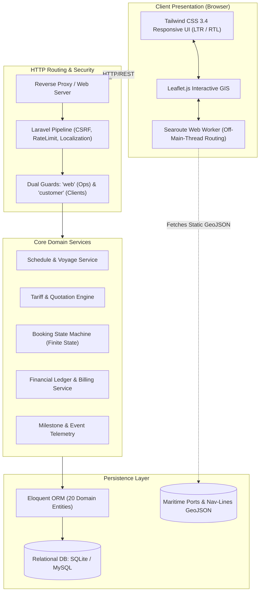

# System Architecture & Technical Design

**System Name:** Freight & Logistics Management System (نظام إدارة الشحن والخدمات اللوجستية)  
**Architecture Style:** Layered Monolith with Client-Side GIS Offloading  
**Runtime:** PHP 8.2+ / Laravel 13 / SQLite / Node.js 22  

---

## 1. High-Level System Architecture

The Freight & Logistics Management System is built as a highly responsive, server-rendered application leveraging Laravel's proven MVC pattern, supplemented by client-side Web Workers for heavy computational geometry tasks.

---

## 2. Key Subsystems & Design Decisions

### 2.1 Dual-Portal & Multi-Role Authentication
The system enforces strict boundary isolation between external customers and internal freight operations personnel:
* **Customer Portal Guard (`customer`):**
  - Authenticates against the `customers` database table.
  - Grants access only to scoped resources (own bookings, own quotes, own invoices).
  - Isolated session cookie keys prevent privilege escalation across portals.
* **Internal Operations Guard (`web`):**
  - Authenticates against the `users` table with granular role-based capabilities (Administrator, Operations Desk, Pricing Specialist, Billing Officer).
  - Manages global carrier tariffs, vessel master data, booking status overrides, and master bill of lading (MBL) assignments.

### 2.2 Client-Side Maritime Routing Engine
Traditional freight software makes expensive backend API calls to calculate maritime voyages between oceanic ports, resulting in server strain, GIS database licensing costs, and high network latency.
* **Architecture Solution:** The system packages oceanic shipping lanes as an optimized static GeoJSON network (~2.1 MB) cached client-side.
* **Execution:** A dedicated Web Worker spawns on page load, executing Dijkstra shortest-path algorithms and geodesic curve interpolation off the main browser thread.
* **Result:** Instantaneous voyage visualization with zero main-thread UI jank, 60fps map panning, and zero backend compute overhead.
*(See detailed analysis in [ADR-001: In-Browser Maritime Routing](decisions/ADR-001-in-browser-maritime-routing.md))*

### 2.3 Relational Domain Model & Booking State Machine
The core logistics domain is modeled across 20 tightly coupled Eloquent entities:
* `Vessel` & `VesselSchedule`: Carrier voyages, port rotations, cut-off dates, and ETD/ETA calculations.
* `Port`: International UN/LOCODE port definitions with latitude/longitude coordinates.
* `Tariff` & `OceanFreightRate`: Base ocean freight rates categorized by container types (`20GP`, `40GP`, `40HC`, `45HC`, Reefer).
* `Booking`: Central operational record tracking status transitions:
  `draft` &rarr; `quote_requested` &rarr; `quote_sent` &rarr; `confirmed` &rarr; `in_transit` &rarr; `arrived` &rarr; `completed`
* `Milestone`: Telemetry events (Gate-in, Customs Passed, On-board, Discharged) with timestamps and location tags.
* `Invoice` & `InvoiceItem`: Auditable commercial billing records with tax and surcharge itemization.

---

## 3. Bilingual Localization & RTL Layout Engine

Maritime logistics in the Middle East and North Africa requires seamless Arabic and English operation.
* **Session-Driven Locale:** Users can toggle between `en` (English, LTR) and `ar` (Arabic, RTL) at any time.
* **Dynamic Directionality:** Blade layout wrappers automatically inject `dir="rtl"` and adjust Tailwind alignment utilities (e.g., `ltr:ml-auto rtl:mr-auto`).
* **Complete Linguistic Neutralization:** All translation keys in `lang/en` and `lang/ar` have been sanitized to reference *Freight & Logistics Management System* without real client brand terms.

---

## 4. Scalability & Operational Characteristics

* **Stateless Application Servers:** Laravel session state can be backed by Redis or Memcached in production clusters.
* **Database Agnostic:** Migrations and Eloquent definitions use standard ANSI SQL datatypes, allowing seamless switching between SQLite (local development and demo testing) and MySQL 8.0 / PostgreSQL 15 (enterprise staging and production).
* **Asset Compilation:** Static assets (Tailwind CSS, Leaflet JS, GeoJSON graphs) are compiled via Vite into minified bundles with immutable cache headers.
