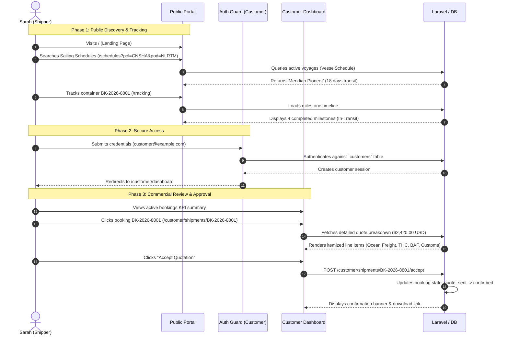

# End-to-End User Journeys

**System:** Freight & Logistics Management System (نظام إدارة الشحن والخدمات اللوجستية)  
**Scope:** Public Discovery, Customer Self-Service, and Booking Lifecycle  
**Data Context:** 100% Synthetic Demo Dataset  

---

## 1. Persona Profiles

To validate and demonstrate the application's capabilities, two primary personas are modeled:

| Persona | Role | Primary Goals | Entry Route |
| :--- | :--- | :--- | :--- |
| **Sarah Chen** | Logistics Director, Global Trade Corp | Search sailing schedules, request spot quotes, track active containers, approve commercial invoices. | `/` &rarr; `/customer/login` |
| **Tariq Al-Mansoor** | Commercial Freight Specialist, Operations Team | Review quote requests, apply carrier markups, manage vessel schedules, issue bills of lading. | `/admin/login` |

---

## 2. Customer Journey: From Discovery to Invoice Settlement

---

## 3. Step-by-Step Scenario Walkthrough

### Step 1: Voyage Schedule Discovery
* **User Action:** Sarah navigates to `/schedules` and selects:
  * **Port of Loading (POL):** `CNSHA` (Shanghai, China)
  * **Port of Discharge (POD):** `NLRTM` (Rotterdam, Netherlands)
* **System Response:** The schedule engine queries available carrier rotations and displays departure dates, transit times, vessel names (*Meridian Pioneer*), and cut-off deadlines.

### Step 2: Milestone Telemetry Lookup
* **User Action:** Sarah visits `/tracking` and inputs reference `BK-2026-8801`.
* **System Response:** An interactive timeline renders each operational event:
  1. *Booking Confirmed* — Jebel Ali Port
  2. *Container Gated In* — Terminal 2 Depot
  3. *Customs Clearance Granted* — Authority Stamp Approved
  4. *Vessel Departed* — High Seas Transit En Route to Alexandria
  5. *Estimated Arrival* — Alexandria Port (Pending)

### Step 3: Authenticated Customer Portal Access
* **User Action:** Sarah logs in at `/customer/login` using the demo credentials:
  * **Email:** `customer@example.com`
  * **Password:** `password`
* **System Response:** The session guard confirms credentials, initializes the customer session, and routes to `/customer/dashboard`.

### Step 4: KPI Dashboard Review
* **User Action:** Sarah reviews real-time operational indicators:
  * **Active Bookings:** 3
  * **Shipments In-Transit:** 2
  * **Pending Quotes:** 1
  * **Outstanding Balance:** $2,420.00 USD
* **System Response:** Dynamic cards display live aggregations calculated directly from scoped Eloquent relations.

### Step 5: Commercial Quotation Acceptance
* **User Action:** Sarah opens booking `BK-2026-8801` to inspect financial details:
  * Ocean Freight (20GP): $1,850.00
  * Origin Terminal Handling Charge (THC): $180.00
  * Destination THC: $220.00
  * Bunker Adjustment Factor (BAF): $110.00
  * Customs Documentation: $60.00
  * **Total:** $2,420.00 USD
* **User Action:** Clicks **Accept Quotation**.
* **System Response:** The booking state transitions to `confirmed`. A confirmation flash alert is rendered, and invoice generation is queued.

---

## 4. Verification Checkpoint

This entire workflow was automatically validated using the browser subagent (`demo_walkthrough_1792061587041.webp`) and feature tests in `Tests\Feature\CustomerPortalTest`, ensuring zero broken links, form errors, or authorization leaks.
